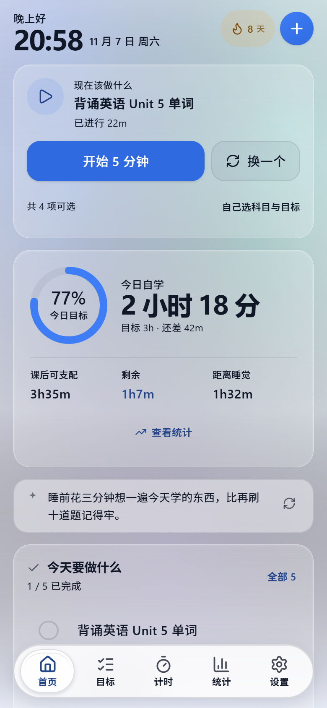
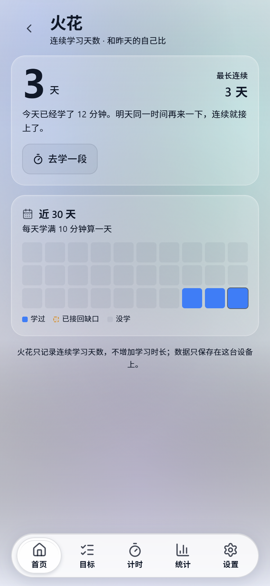
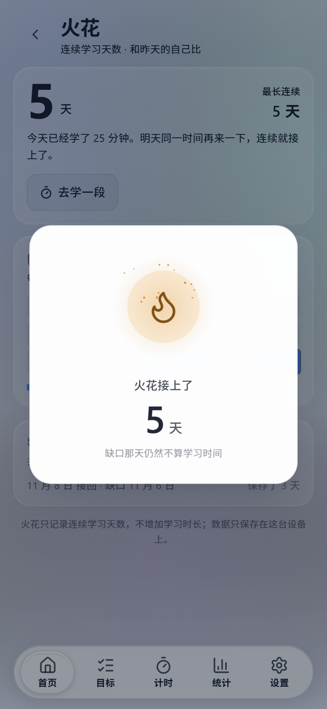

# 学习 OS（Learning OS）

一个 **Android 优先、本地优先** 的个人学习管理应用：计划、计时、统计、火花（连续学习）、
成就、考试成绩，全部数据只保存在你自己的设备上。没有账号、没有后端、没有排行榜。

> 这是一个个人项目，按自己的学习习惯做的；代码开源出来，欢迎参考、改造成适合你自己的版本。
> 当前版本 **1.4.2**（Android APK 见 Releases，或自行构建）。





## 它能做什么

- **今日自学 / 可支配时间**：按作息、课程表计算今天还能学多久；上课时间不计入学习时长。
- **目标与计时**：计划时长、真实时间戳计时、暂停不计费、切后台/锁屏如实计时；支持成果目标（不计时）。
- **统计**：概览、日历、热力图、**考试成绩 vs 目标分**、**成就 10 项**；没有排行榜，只跟昨天的自己比。
- **火花（连续学习天数）**：每天学满 10 分钟算一天；断签后有两日修复规则，接回成功有复燃动画；
  只补连续天数，缺口日不算学习时间、不产生任何学习记录。
- **重要日期 / 课程表 / 作业清单 / 固定日程**。
- **六套主题 + 液态玻璃折射材质**，支持深色、减少动效、省电模式。
- **无障碍**：跳过导航、路由标题、弹层/专注模式语义、键盘可操作、对比度门禁。

## 明确不做的

- 排行榜、社交、竞争、打卡攀比。
- 云同步 / 多设备同步（数据只在本机；导出/导入 JSON 自己搬）。
- 系统通知/提醒（规划中，见 `docs/还有啥没做.md`）。

## 技术栈

React 19 + TypeScript + Vite 7 + Tailwind 4（CSS-first tokens）+ Zustand + React Router（HashRouter）
+ Capacitor 8（Android）+ PWA（vite-plugin-pwa）。玻璃材质有自研 WebGL 折射层与透明玻璃底层。

## 下载

到 [Releases](../../releases) 下载对应文件：

| 文件 | 用途 |
|---|---|
| `LearningOS-vX.Y.Z.apk` | 直接装到 Android 手机；覆盖安装保留数据（侧载，需要允许未知来源） |
| `LearningOS-vX.Y.Z-web.zip` | 已构建的静态 Web/PWA，解压丢到任意静态服务器即可 |
| `LearningOS-vX.Y.Z-source.zip` | 源码快照，不装 Git 也能看；解压后 `npm ci && npx tsc -b && npm run build` |
| `SHA256SUMS.txt` | 校验和：`Get-FileHash -Algorithm SHA256 <文件>` 或 `sha256sum -c` |

更长的介绍（为什么做、适合谁、设计原则、已知边界）见 [docs/项目介绍.md](docs/项目介绍.md)。

## 本地运行（Web）

需要 Node.js **20+**（推荐 22）。

```bash
npm ci
npm run dev          # http://localhost:5173
npx tsc -b           # 类型检查
npm run build        # 生产构建
```

可选端点（不配置则相关功能静默关闭）：

```bash
cp .env.example .env.local
# VITE_GITHUB_REPO=owner/learning-os   # 自动检查 GitHub Releases 更新（推荐，开源用）
# VITE_UPDATE_MANIFEST_URL=           # 或自建版本清单（GET JSON）
# VITE_FEEDBACK_URL=                  # 意见箱接收地址（POST JSON）
```

### 自动检查更新（GitHub Releases）

构建时设置 `VITE_GITHUB_REPO=你的用户名/仓库名`，App 启动后会自动查
`GET https://api.github.com/repos/<owner>/<repo>/releases/latest`：

- 取 `tag_name`（如 `v1.4.3`）与当前版本按语义化版本比较，比当前新才提醒；
- APK 直接取该 Release 里第一个 `.apk` 资产的下载地址；
- 6 小时内最多检查一次；离线/超时/500/坏 tag 都静默当作「没有更新」；
- 同一版本点过「以后再说」不再提醒，出现更新的版本会再提；
- 不会带 `Authorization`、不带任何学习数据；未配置仓库时连请求都不发。

安卓不经过应用商店**无法静默安装**，所以点「下载并安装」会打开浏览器下载，
再由系统安装器确认——这是平台限制，不是没做。

> 发布新版本时记得在 GitHub Release 里上传 `LearningOS-vX.Y.Z.apk`，
> 并把 tag 写成 `vX.Y.Z`；否则自动更新找不到下载地址。


## 构建 Android APK

需要 JDK **21**、Android SDK（compileSdk 36 / targetSdk 36 / minSdk 24）。

```bash
VITE_TARGET=android npm run build
npx cap sync android
cd android
./gradlew assembleRelease        # Windows: .\gradlew.bat assembleRelease
```

签名：项目期望 `android/learningos.jks` + `android/keystore.properties`（均已被 gitignore，
**不随仓库分发**）。没有密钥时会退回 debug 签名，仍可构建但不能覆盖安装正式包。

## 测试

```bash
npx tsc -b                     # 必须 0 错
node scripts/check-quotes.mjs  # 纯 Node，可在 CI 跑
```

大部分界面/像素测试需要本机 Chrome 与三个服务器（5188 dev / 5189 第二 dev / 4173 preview），
完整说明见 `docs/还有啥没做.md` 附录 A；整套回归 `node scripts/run-regression.mjs` 约 21 分钟。

## 数据与隐私

- 学习数据保存在浏览器 **IndexedDB / localStorage**（Android WebView 内同源），不经过任何服务器。
- 没有账号系统；导出/导入为本地 JSON 文件。
- 唯一的网络请求：可选的网络校时（失败自动回退本机时间）、可选的更新检查、可选的反馈提交。
  后两者未配置端点时整块功能不出现。
- 意见箱默认只带版本号与平台；学习数据统计量需用户主动勾选。

## 目录

```
src/
  pages/           页面（首页、目标、计时、统计、日历、火花、设置）
  components/      卡片、图表、弹层、设置分区、玻璃材质
  lib/             纯逻辑：持久化/store、时间、统计、火花、成就、成绩、评价
  glass/           自研玻璃渲染（WebGL 折射、背景画布）
  styles/          设计令牌与全局样式
android/           Capacitor 安卓工程
scripts/           测试与审计脚本（Playwright 驱动）
docs/              方案、更新说明、截图、待办
```

## 参与

欢迎 issue / PR；先读 `CONTRIBUTING.md`。安全问题请不要公开 issue，见 `SECURITY.md`。

## 许可

[MIT](LICENSE) © 2026 Learning OS contributors。
第三方依赖与内置代码的许可见 [THIRD-PARTY-NOTICES.md](THIRD-PARTY-NOTICES.md)。

## 免责声明

这是一个学习辅助工具，不构成任何教育、心理或医疗建议；成绩记录只是记录，不计入学习时长；
连续性规则与提醒都按代码里写明的口径执行。作者不对使用效果做承诺。
